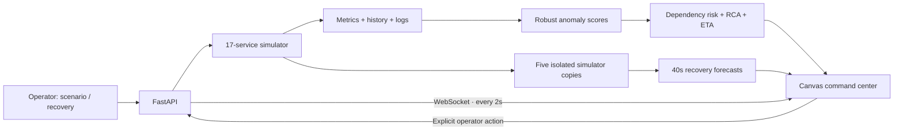

# CascadeGuard AI

**See the cascade. Stop the outage.**

An explainable incident command center for **ORCATHON 2026 · Track 01, Software & AI**. CascadeGuard models a 17-service commerce system, detects anomalous telemetry, identifies a likely failure origin, and compares five recovery actions before you apply one.

[Live demo](https://afford-fairy-mileage-penguin.trycloudflare.com) · [API documentation](https://afford-fairy-mileage-penguin.trycloudflare.com/docs) · [Event](https://unstop.com/hackathons/orca-coders-orcathon-devharbour-1768929)

> This is an interactive **synthetic digital-twin prototype**. It does not monitor a real production system. Risk, evidence strength, time-to-failure, and strategy costs are model estimates; they are not calibrated probabilities or measured production outcomes. All visitors share the same sandbox.

## Why it matters

A failed payment database can cascade through payment processing, orders, and the gateway. A dashboard that only shows the gateway turning red leaves an operator guessing where to act. CascadeGuard connects a leading anomaly to its dependency impact and a concrete recovery comparison in one workspace.

## Try it in 90 seconds

1. Open the demo. Click **Focus view** for a compact presentation workspace.
2. Keep **Payment database degradation**, then click **Run scenario**. This resets the shared sandbox to a reproducible starting state and injects a fault into `payment-db`.
3. After approximately 6–10 seconds, inspect **Root cause**, **Failure forecast**, and **Impact chain**. Exposed callers can appear while still healthy. Forecast timing depends on the evolving metrics.
4. Scroll to **Recovery strategy lab**. Compare the forecast mean risk, assumed downtime, and utility of all five actions. The best strategy can change with incident timing.
5. Click **Apply best recovery**, then observe recovery over subsequent ticks. Applying a fix is not the same as instant recovery.
6. **Export incident** downloads the current metrics, analysis, buffered logs, and action history. Try the cache and search scenarios to explore different dependency paths.

Graph clicks inspect service telemetry. Fault injection is an explicit action. The service selector provides keyboard access to the same metrics. Logs can be paused or filtered by severity and selected service.

## What the engine actually does

| Stage | Method | What it means |
|---|---|---|
| Detect | Recent four-sample latency/error means vs a rolling baseline, scaled by median absolute deviation with noise floors | Robust anomaly evidence; not a learned failure classifier |
| Propagate | Intrinsic anomaly/health score plus attenuated risk from the weakest dependency, evaluated across the DAG | A heuristic exposure score for each caller |
| Forecast | Health decline slope over the recent eight samples, extrapolated to the failure threshold | An approximate ETA only when a declining trend exists |
| Explain | Prefer anomalous services without an anomalous direct dependency; rank using signal strength and affected callers | A suspected origin and visible evidence, not proven causality |
| Compare | Clone the current simulator, apply each real action implementation, and run 20 ticks / 40 simulated seconds with identical random streams | A comparable counterfactual forecast using the same model as execution |
| Recover | Apply the chosen action in the live synthetic sandbox; stream subsequent observed metrics | The operator sees whether the simulated chain actually recovers |

Utility is `mean operational-risk reduction / (1 + assumed downtime_seconds / 60)`. Reduction is displayed in **risk points**, not a percentage improvement. Counterfactual operational risk is a propagated health deficit; the overview cascade score additionally incorporates metric anomalies. The interface names these separately.

A circuit breaker isolates the source from callers for 40 seconds; it does **not** heal the source and can sacrifice the dependent feature. Scale-out reduces fault pressure without clearing it. Restart, failover, and rollback clear the active simulated fault and apply different health gains. Downtime is a scoring assumption, not an enforced delay.

The recovery evaluator has access to the simulator’s current fault state. A real digital twin would need to estimate that state from instrumentation and incident evidence. Five strategy trials are a bounded comparison, not a claim of global optimality.

## Architecture



- `simulator.py`: service DAG, local seeded random generator, synthetic metrics/logs, persistent timed isolation, recovery actions. Dependency health is read from the previous tick, so dictionary iteration does not create instant multi-hop propagation.
- `engine.py`: anomaly scoring, risk propagation, evidence-based origin ranking, trend forecasts, isolated counterfactual trials.
- `main.py`: validated REST endpoints, cached analysis per simulation tick, WebSocket stream, health endpoint, export; graceful ticker lifecycle and absolute static paths.
- `static/`: dependency-free responsive dashboard with connection/stale-state feedback, disabled invalid actions, focus mode, keyboard controls, and reduced-motion support.
- `tests/`: deterministic causal/recovery tests and an optional live API smoke script. GitHub Actions runs engine tests and JavaScript syntax validation.

## Run locally

Python 3.9+; no API keys, paid services, database, or frontend build step required.

```bash
python3 -m venv venv
venv/bin/pip install -r requirements.txt
venv/bin/uvicorn main:app --host 0.0.0.0 --port 8000
# http://localhost:8000
```

Use a **single worker**: simulation state is in memory. This prototype is deliberately shared and resets on server restart. Multiple workers would create inconsistent worlds. A public demo visitor can inject faults or reset the sandbox; this is intentional demo functionality, not a production control plane.

```bash
python3 -m unittest discover -s tests -p 'test_*.py' -v
node --check static/app.js
# Optional: run against a separate disposable preview; this resets that sandbox:
venv/bin/python tests/smoke_api.py http://127.0.0.1:8001
```

## Verification

The local polish pass passed **9 engine tests**, covering nominal stability, root-cause identification across **17 services × 3 seeds**, prediction of a still-healthy caller before failure, forecast/action parity for five strategies, forecast non-mutation and repeatability, full-chain recovery, circuit-breaker isolation and expiry, reset, and invalid strategy rejection. The local HTTP/WebSocket smoke run passed **14 checks** including validation, scenario, remediation, export, and streaming. These are synthetic test results, not real-world accuracy benchmarks.

## API

| Endpoint | Purpose |
|---|---|
| `GET /healthz` | Liveness, mode, service count and tick |
| `GET /api/state` | Current synthetic telemetry and analysis |
| `WS /ws` | Live state and analysis, every 2 seconds |
| `POST /api/scenario` | Reset and run `{scenario: "payment"\|"cache"\|"search"}` |
| `POST /api/chaos` | Inject `{service?: "payment-db"}` |
| `POST /api/fix` | Apply `{service, strategy}` |
| `POST /api/reset` | Restore a seeded healthy reference state |
| `GET /api/report` | Download current incident JSON |
| `GET /docs` | Interactive OpenAPI documentation |

## Scope and next steps

Production ingestion, learned fault models, calibrated uncertainty, authenticated per-team sessions, durable storage, and integrations with actual infrastructure are future work. The simulator seeds 24 synthetic healthy reference samples to make the demo immediately usable; these are model initialization samples, not historical observations. Forecasts use a rolling baseline and can adapt to prolonged incidents.

The Cloudflare quick-tunnel URL is temporary and requires the local server, tunnel process, and machine to remain available. Keep the current tunnel running through judging. The repository remains the reproducible fallback if the tunnel expires.

## Contribution and tools disclosure

Solo project by **Shikhar / [sgoel2be24-cyber](https://github.com/sgoel2be24-cyber)**. The original handover reports that the initial project was built during the event and used no project code written before the event; confirm that timeline against your own records before submitting. The initial simulator, engine, API, and dashboard already existed before this polish pass. This pass improved recovery modeling, validation, reproducibility, interface design, tests, and documentation.

Tools: Python, FastAPI, Uvicorn, Pydantic, WebSockets, vanilla JavaScript, HTML Canvas, CSS, Cloudflare Tunnel, Git/GitHub. AI-assisted development: **OpenCode** for the initial build (per handover), **OpenAI Codex** for this polish pass. No LLM API runs in the product. Third-party framework/library use is distinct from pre-existing project code.
