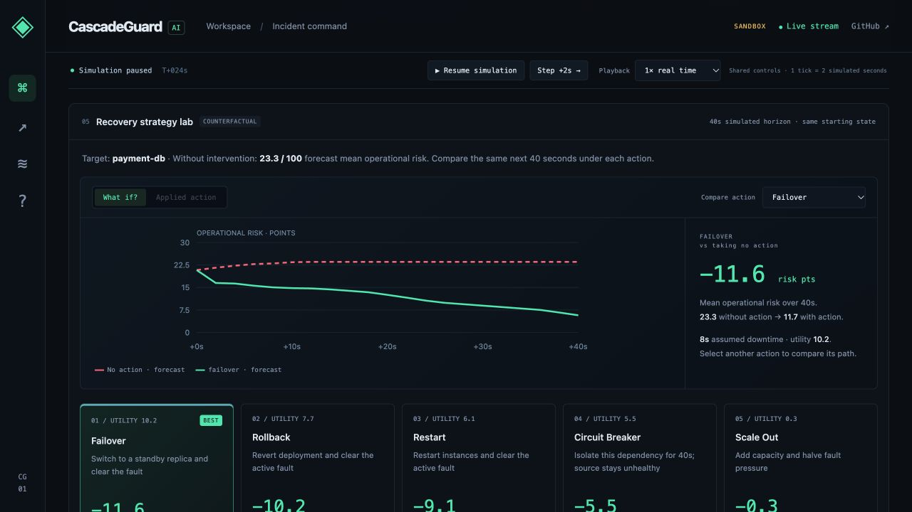
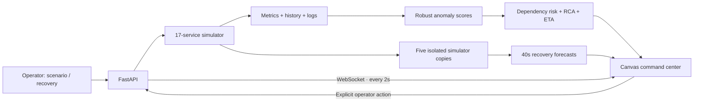

# CascadeGuard AI

**See the cascade. Stop the outage.**

An explainable incident command center for **ORCATHON 2026 · Track 01, Software & AI**. CascadeGuard models a 17-service commerce system, detects anomalous telemetry, identifies a likely failure origin, and compares five recovery actions before you apply one.

[Live demo](https://afford-fairy-mileage-penguin.trycloudflare.com) · [API documentation](https://afford-fairy-mileage-penguin.trycloudflare.com/docs) · [Event](https://unstop.com/hackathons/orca-coders-orcathon-devharbour-1768929)

> This is an interactive **synthetic digital-twin prototype**. It does not monitor a real production system. Risk, evidence strength, time-to-failure, and strategy costs are model estimates; they are not calibrated probabilities or measured production outcomes. All visitors share the same sandbox.



## Why it matters

A failed payment database can cascade through payment processing, orders, and the gateway. A dashboard that only shows the gateway turning red leaves an operator guessing where to act. CascadeGuard connects a leading anomaly to its dependency impact and a concrete recovery comparison in one workspace.

## Judge walkthrough

1. Click **Start guided demo**. It prepares a seeded payment incident at T+16s, pauses it, and opens a five-step walkthrough.
2. Inspect the topology, suspected origin, healthy callers at risk, and observed service trends.
3. Compare the five recovery trajectories. Apply the computed best action; the guide plays at 4× and holds the completed outcome.
4. Inspect the **Predictive vs reactive evidence lab**. Download the case-level report or reproduce it locally.
5. Exit the guide and try another mechanism: **cache capacity exhaustion**, **search deployment regression**, or **queue network partition**. At the prepared T+16s state these favor scale-out, rollback, and temporary isolation respectively.
6. Remove standby availability or set the assumed downtime budget to zero. Rankings and the execution API enforce the same policy. Arm the optional **predictive guard** to let the planner act and re-plan after its 40-second horizon.

Every visitor shares the sandbox. The guided demo and scenario controls reset it. Graph clicks inspect services; fault injection remains explicit. Export the incident before resetting.

## What the engine actually does

| Stage     | Method                                                                                                                                    | What it means                                                          |
| --------- | ----------------------------------------------------------------------------------------------------------------------------------------- | ---------------------------------------------------------------------- |
| Detect    | Recent four-sample latency/error means vs a rolling baseline, scaled by median absolute deviation with noise floors                       | Robust anomaly evidence; not a learned failure classifier              |
| Propagate | Intrinsic anomaly/health score plus attenuated risk from the weakest dependency, evaluated across the DAG                                 | A heuristic exposure score for each caller                             |
| Forecast  | Health decline slope over the recent eight samples, extrapolated to the failure threshold                                                 | An approximate ETA only when a declining trend exists                  |
| Explain   | Prefer anomalous services without an anomalous direct dependency; rank using signal strength and affected callers                         | A suspected origin and visible evidence, not proven causality          |
| Compare   | Clone the current simulator, apply each real action implementation, and run 20 ticks / 40 simulated seconds with identical random streams | A comparable counterfactual forecast using the same model as execution |
| Recover   | Apply the chosen action in the live synthetic sandbox; stream subsequent observed metrics                                                 | The operator sees whether the simulated chain actually recovers        |

Utility is `mean operational-risk reduction / (1 + assumed downtime_seconds / 60)`. Reduction is displayed in **risk points**, not a percentage improvement. Counterfactual operational risk is a propagated health deficit; the overview cascade score additionally incorporates metric anomalies. The interface names these separately.

Recovery effects depend on explicit synthetic fault mechanisms. Failover repairs the modeled replica failure, scale-out clears modeled capacity exhaustion, and rollback clears a modeled deployment regression. Instance actions cannot repair a network partition. A circuit breaker shields callers for 40 seconds without healing the source and may sacrifice the dependent feature. These response rules are simulator assumptions; the preferred action is computed by rolling out all five alternatives, not by looking up a recommended action. Downtime is an assumed planning cost, not an enforced outage.

Policy defaults allow 60 seconds of assumed downtime and an available standby. Infeasible actions are visible but blocked in both the ranking and execution API. The opt-in predictive guard uses the same inferred origin, forecasts and feasible actions; it can re-plan after a 40-second cooldown. Reset disarms it.

## Paired evidence, with inspectable controls

`python scripts/evaluate.py` reproduces **40 cases: four fault mechanisms × ten seeds excluded from the demo design seed**. Four policies share the initial system and physical-noise stream: predictive intervention, reactive intervention after gateway failure, no recovery, and one early action without re-planning. Physical noise and decorative logs use separate RNGs, with a fixed draw count per physical tick.

The dashboard reports gateway-failed time and service unavailability (failed **or isolated** service-seconds), so containment has a visible cost. The downloadable JSON includes every action and tick trajectory. A SHA-256 fingerprint marks reports stale after relevant implementation changes. The saved study uses default recovery constraints; changing the live policy does not rewrite it.

Saved 40-case result (default policy, 160 simulated seconds per case):

| Policy | Mean gateway-failed seconds | Mean unavailable service-seconds |
|---|---:|---:|
| Predictive guard | 0.00 | 24.25 |
| Reactive recovery | 40.30 | 115.75 |
| No recovery | 91.90 | 287.40 |
| Single early action | 16.05 | 57.90 |

Unavailable service-seconds count a service once per tick when failed or isolated. The predictive policy reduces that measure by 79.0% relative to the reactive baseline in this experiment.

These experiments compare policies within this synthetic model. They do not validate production prediction accuracy. The modeled response rules, topology, seed selection, 160-second horizon and assumed downtime constrain the result. Forecast/observed agreement uses the same simulator and is a consistency check.

The recovery evaluator has access to the simulator’s current fault state. A real digital twin would need to estimate that state from instrumentation and incident evidence. Five strategy trials are a bounded comparison, not a claim of global optimality.

## Architecture



- `simulator.py`: service DAG, local seeded random generator, synthetic metrics/logs, persistent timed isolation, recovery actions. Dependency health is read from the previous tick, so dictionary iteration does not create instant multi-hop propagation.
- `engine.py`: anomaly scoring, risk propagation, evidence-based origin ranking, trend forecasts, isolated counterfactual trials.
- `evaluation.py`: paired offline policy experiments, case-level trajectories and implementation fingerprint.
- `runtime.py`: playback controls, tick-based incident journal, inferred initial origin retention, measured warning lead time, observed recovery outcomes and saved forecast comparisons.
- `main.py`: validated REST endpoints, cached analysis per state revision, WebSocket stream, health endpoint, export; graceful ticker lifecycle and absolute static paths.
- `static/`: dependency-free responsive dashboard with connection/stale-state feedback, disabled invalid actions, focus mode, keyboard controls, and reduced-motion support.
- `tests/`: deterministic causal/recovery tests and an optional live API smoke script. GitHub Actions runs engine tests and JavaScript syntax validation.

## Run locally

Python 3.9+; no API keys, paid services, database, or frontend build step required.

```bash
python3 -m venv venv
venv/bin/pip install -r requirements.txt
venv/bin/uvicorn main:app --host 0.0.0.0 --port 8000
# http://localhost:8000
```

Use a **single worker**: simulation state is in memory. This prototype is deliberately shared and resets on server restart. Multiple workers would create inconsistent worlds. A public demo visitor can inject faults or reset the sandbox; this is intentional demo functionality, not a production control plane.

```bash
python3 -m unittest discover -s tests -p 'test_*.py' -v
node --check static/app.js
node --check static/insights.js
node --check static/rubric.js
# Optional: run against a separate disposable preview; this resets that sandbox:
venv/bin/python tests/smoke_api.py http://127.0.0.1:8001
```

## Verification

The local polish pass passed **20 engine/runtime tests**, covering nominal stability, root-cause identification across **17 services × 3 seeds**, prediction of a still-healthy caller before failure, forecast/action parity for five strategies, forecast non-mutation and repeatability, full-chain recovery, circuit-breaker isolation and expiry, reset, and invalid strategy rejection. The local HTTP/WebSocket smoke run passed **81 checks** including validation, scenario, remediation, export, and streaming. These are synthetic test results, not real-world accuracy benchmarks.

## API

| Endpoint             | Purpose                                                                         |
| -------------------- | ------------------------------------------------------------------------------- |
| `GET /healthz`       | Liveness, mode, service count and tick                                          |
| `GET /api/state`     | Current synthetic telemetry and analysis                                        |
| `WS /ws`             | Changed state plus a 2-second heartbeat; supports pause and accelerated ticks   |
| `POST /api/scenario` | Reset and run `{scenario: "payment"\|"cache"\|"search"}`                        |
| `POST /api/chaos`    | Inject `{service?: "payment-db"}`                                               |
| `POST /api/fix`      | Apply `{service, strategy}`                                                     |
| `POST /api/reset`    | Restore a seeded healthy reference state                                        |
| `GET /api/report`    | Download current incident JSON, journal and forecast trajectories               |
| `POST /api/control`  | Pause/resume or set wall-clock speed `{paused?: true, speed?: 1\|2\|4}`         |
| `POST /api/step`     | Advance exactly one 2-second simulated tick while paused; otherwise returns 409 |
| `GET /docs`          | Interactive OpenAPI documentation                                               |

## Scope and next steps

Production ingestion, learned fault models, calibrated uncertainty, authenticated per-team sessions, durable storage, and integrations with actual infrastructure are future work. The simulator seeds 24 synthetic healthy reference samples to make the demo immediately usable; these are model initialization samples, not historical observations. Forecasts use a rolling baseline and can adapt to prolonged incidents.

The Cloudflare quick-tunnel URL is temporary and requires the local server, tunnel process, and machine to remain available. Keep the current tunnel running through judging. The repository remains the reproducible fallback if the tunnel expires.

## Contribution and tools disclosure

Solo project by **Shikhar / [sgoel2be24-cyber](https://github.com/sgoel2be24-cyber)**. The original handover reports that the initial project was built during the event and used no project code written before the event; confirm that timeline against your own records before submitting. The initial simulator, engine, API, and dashboard already existed before this polish pass. This pass improved recovery modeling, validation, reproducibility, interface design, tests, and documentation.

Tools: Python, FastAPI, Uvicorn, Pydantic, WebSockets, vanilla JavaScript, HTML Canvas, CSS, Cloudflare Tunnel, Git/GitHub. AI-assisted development: **OpenCode** for the initial build (per handover), **OpenAI Codex** for this polish pass. No LLM API runs in the product. Third-party framework/library use is distinct from pre-existing project code.

## Second polish pass: operate, compare, verify

- **Pause / Step +2s / 1×–4×:** Freeze the simulation while explaining evidence, advance one causal tick at a time, or accelerate recovery. Simulation timestamps always advance by two seconds per tick. Playback controls are shared. New scenarios preserve playback settings; Reset restores a running 1× world. WebSocket heartbeat continues while paused, so paused and disconnected are visibly distinct.
- **Service trends:** Health, latency, error rate and CPU charts use observed synthetic samples only; the seeded initialization window is excluded. Service selection works from the graph and keyboard-accessible selector.
- **What-if explorer:** Plot no action against any of the five recovery trajectories. Selecting an action for comparison does not apply it.
- **Applied-action replay:** Retain the selected action’s starting forecast and overlay subsequent observed operational risk. Additional faults mark the pending comparison interrupted. A completed horizon reports mean absolute deviation as a same-model consistency check; this is not independent forecast validation.
- **Incident evidence:** Record first detection latency, the first inferred origin, maximum observed affected/failed services, and recovery time. Initial origin comes from anomaly/graph evidence, not the injected target label. Current RCA is still free to change as symptoms evolve.
- **Measured warning lead:** A lead is recorded only if a service was healthy when the model warned about it and later failed. Warnings that never become failures are not converted into an accuracy claim; remediation may have prevented the failure.
- **Resolution:** An incident resolves after three consecutive ticks with all services healthy, no active injected fault and no current root-cause anomaly. Reset or a fresh scenario clears this in-memory evidence. Export before resetting to preserve the report.

The 20-test suite additionally covers playback locking, exact stepping, speed semantics, world reset identities, inferred-origin retention, observed lead-time ordering, trajectory summary parity, forecast/observed consistency, and interruption by a new fault.
